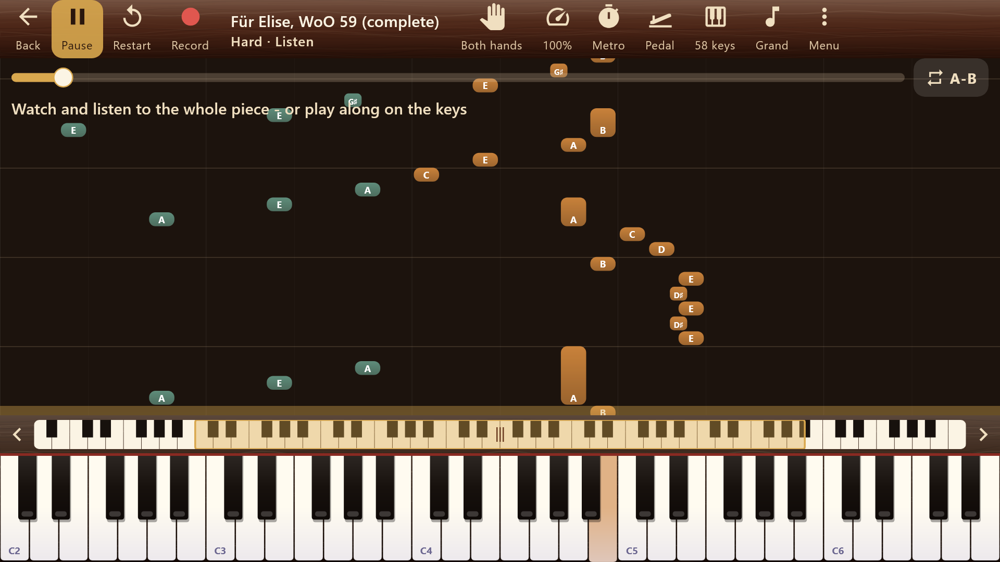
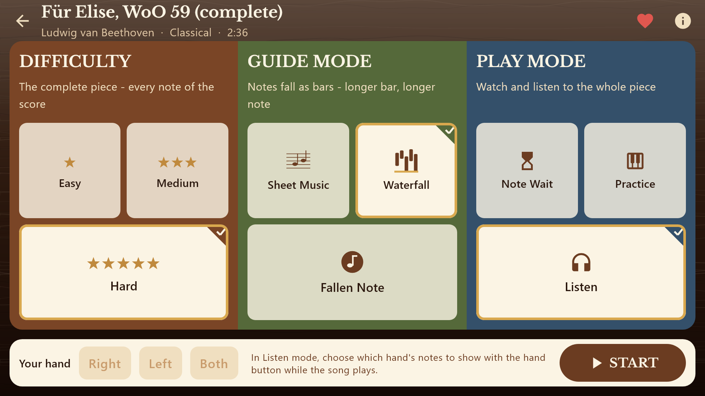
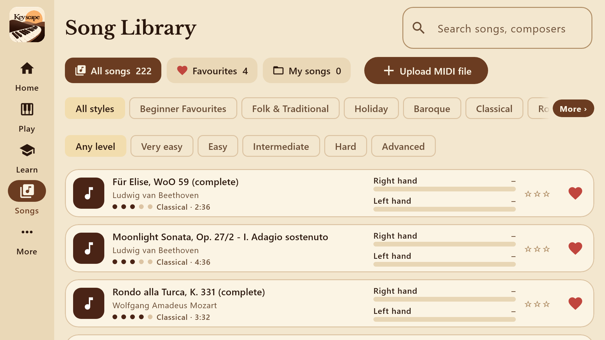
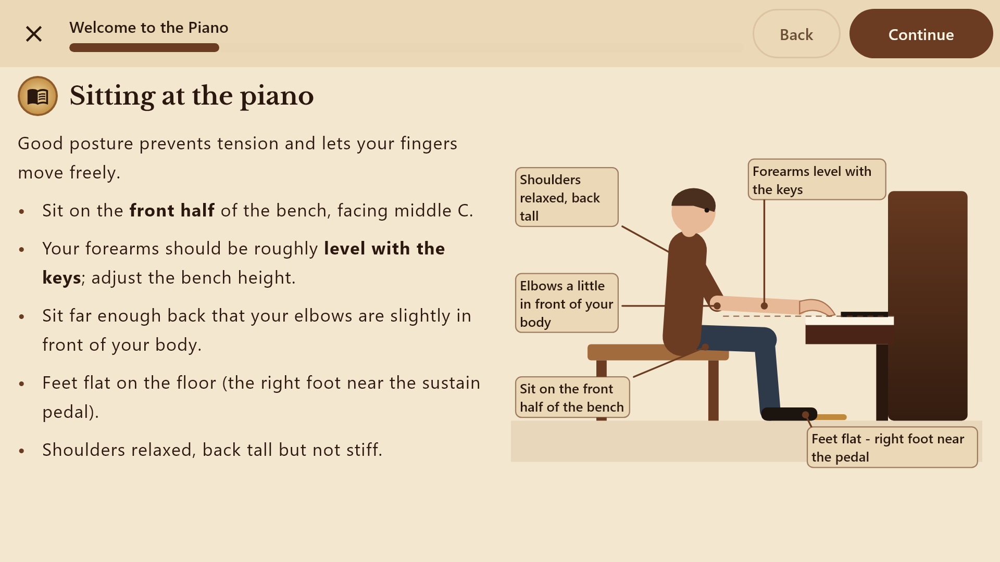
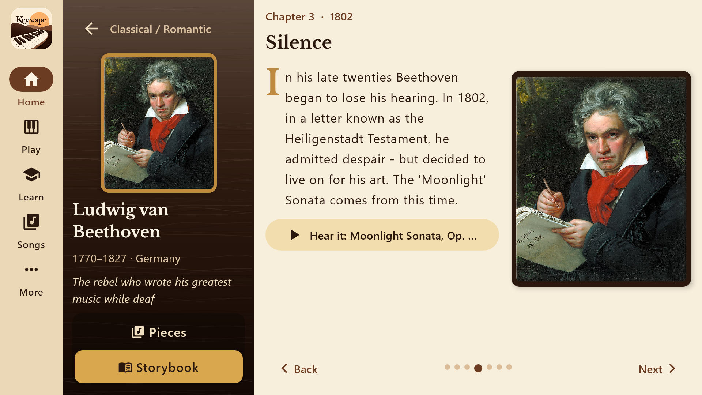
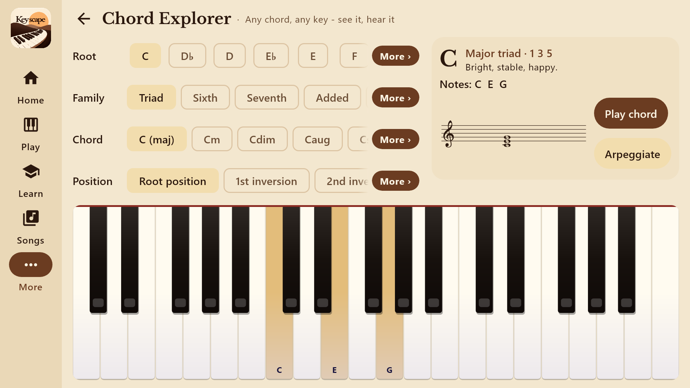
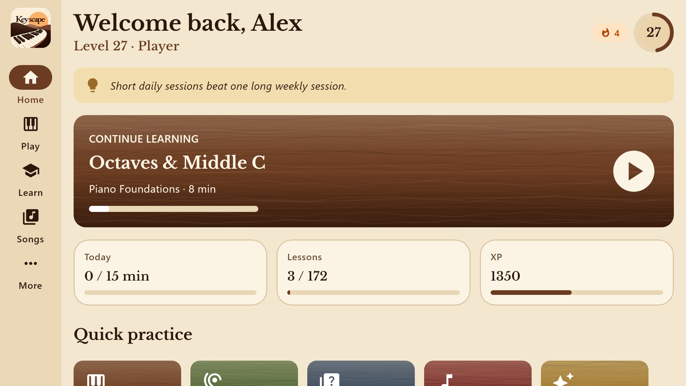

# Keyscape 🎹

*Play Beyond the Ordinary*

Keyscape is a complete piano school for Android phones and tablets (and Windows): structured courses from your very first
note, 222 pieces with falling notes or real sheet music, practice tools, composer storybooks and USB MIDI keyboard support.
It is built with Kotlin and Compose Multiplatform, has no ads, no account and no internet access.



| Song setup | Song library |
|---|---|
|  |  |
| **Lessons** | **Composer storybooks** |
|  |  |
| **Chord Explorer** | **Home** |
|  |  |

## What's inside

- **14 courses, 172 lessons**, each unit ending in a test: Piano Foundations, Music Theory A–Z, Classical, Romantic, Jazz,
  Pop & Modern, Blues & Boogie, Gospel, Latin, Film & Neo-Classical, Improvisation, Ear Training, Sight-Reading and Technique Lab.
  All lessons are open from day one; lessons are paged so they never scroll, with illustrations and the keyboard pinned to the bottom.
- **222 pieces**, including **184 complete, note-exact scores** by 30 composers (Mutopia Project) - Für Elise, all three movements
  of the Moonlight and Pathétique sonatas, Rondo alla Turca, Chopin's nocturnes, études and the Fantaisie-Impromptu, Clair de Lune,
  the Gymnopédies, the Maple Leaf Rag and many more. Every piece is complete, with **Easy / Medium / Hard** levels.
- **Song setup and player:** three guide modes (Waterfall, Fallen Note, scrolling Sheet Music), three play modes (Note Wait,
  Listen, Practice), either hand or both, 10–200 % speed, A-B loop, metronome that follows the score, a sustain pedal taken
  from the score (or generated for pieces without one), recording and replay, 8 to 88 keys with pinch-to-zoom, and a result
  screen with per-hand scores. Favourites and your own MIDI files ("My songs").
- **Composers:** 27 composer pages with portraits, their pieces and an illustrated storybook with a timeline and quiz.
- **Practice tools:** Chord Explorer, Chord Finder, Scale & Mode Explorer (23 scales and modes), Circle of Fifths,
  Progression Player, Metronome, Ear Trainer, Note Reading Trainer and a Theory Encyclopedia of 208 terms.
- **Sound:** sampled concert grand (Salamander Grand Piano, 3 velocity layers) plus 29 more instruments, and a sound-engineering
  panel (reverb, room size, pedal sustain, touch sensitivity, EQ, chorus, drive, tremolo, transpose, tuning, pitch bend).
- **Progress:** levels, XP, streaks, practice calendar, achievements, song of the day.
- **Accessibility:** text and display size, high contrast, colour-blind friendly hand colours, reduced motion, larger key labels,
  vibration on key press, a flash on the beat and keep-screen-on. Phone and tablet layouts.

## MIDI keyboards

- **Android:** connect a digital piano with a USB-OTG adapter; it is detected automatically and reconnects if the cable drops out.
  Settings shows a MIDI activity light and a Reconnect button; audio runs on a low-latency output that tunes itself to the
  device. Bluetooth MIDI keyboards work once paired in Android's MIDI settings.
- **Windows:** connect by USB, then Settings → MIDI keyboard → Refresh → Connect.
- If your piano makes its own sound, turn off "Play sound through the app".
- **Computer keyboard (Windows):** `A S D F G H J K L ;` white keys, `W E T Y U O P` black keys, `Z` / `X` octave down / up,
  `Space` sustain pedal, `Esc` back.

## Publishing on Google Play

Follow **[docs/PlayStore-Deployment-Guide.pdf](docs/PlayStore-Deployment-Guide.pdf)** step by step (account, upload key,
privacy policy, store listing, the 14-day closed test, launch). Supporting files:

- `docs/play-store/listing.md` - store texts, release notes and the answers for every Play Console form.
- `docs/play-store/*.png` - app icon, feature graphic, 8 phone and 8 tablet screenshots (24-bit PNG).
- `docs/privacy-policy.html` - the privacy policy, published with GitHub Pages
  (https://abhijay-nagal.github.io/Keyscape/privacy-policy.html once Pages is switched on).
- `docs/guide-src/` - the HTML source of the guide.

## Building

You need JDK 17 and the Android SDK (platform 36); put the SDK path in `local.properties` (`sdk.dir=...`).

```
./gradlew :composeApp:bundleRelease       # Google Play bundle (.aab)
./gradlew :composeApp:assembleRelease     # installable Android APK
./gradlew :composeApp:run                 # run the desktop app
./gradlew :composeApp:packageReleaseMsi   # Windows installer
./gradlew :composeApp:desktopTest         # unit and content-validation tests
SCREENSHOTS=true ./gradlew :composeApp:desktopTest --tests '*ScreenshotTest.storeAssets'   # regenerate the store graphics
```

Release builds are signed with the upload key in `keystore/`, referenced by `keystore.properties`. Both are deliberately
**not** in this repository - keep your own backup (see the deployment guide, step 2). Without them, release builds fall back
to the debug key, which Google Play rejects. Finished builds are copied to `dist/` (also not committed); attach the APK to a
GitHub Release if you want to offer it for download.

Version numbers live in `composeApp/build.gradle.kts` (`versionCode`, `versionName`, `packageVersion`) and in
`AppInfo.kt` (`VERSION`); raise `versionCode` for every upload to Google Play.

### Project layout

```
composeApp/src/
  commonMain/   shared code: all UI, content, audio synthesis, theory engine
    theory/     pitches, intervals, scales, chords, keys, Roman numerals
    audio/      polyphonic synthesizer, sampled piano, instruments, reverb
    input/      PianoInput hub, MIDI parsing, computer-keyboard mapping
    data/       songs, courses (the curriculum), composers, drills, glossary, progress
    ui/         theme, components (keyboard, staff, visuals...), screens
  androidMain/  AudioTrack output, android.media.midi, MainActivity
  desktopMain/  Java Sound output, javax.sound.midi, main()
  commonTest/, desktopTest/   tests, screenshot and store-graphic renderers
docs/           deployment guide, privacy policy, store listing and graphics, credits
promo/          scripts that recorded and edited the promo video (recordings and output are not committed)
```

Courses are written in a small Kotlin DSL (`data/courses/*.kt`); songs are either compact text notation (`data/Music.kt`) or
Standard MIDI Files (`composeResources/files/midi`). The tests check every lesson, song, chord and generated question.

## Credits

- Complete scores: [Mutopia Project](https://www.mutopiaproject.org) (public domain / CC BY / CC BY-SA); each source is credited in the app under More → About.
- Grand piano samples: Salamander Grand Piano V3 by Alexander Holm (CC BY 3.0); see `docs/SALAMANDER_README.txt`.
- Pictures: Wikimedia Commons, public domain / CC0 (`docs/images.json`).
- Fonts: Bravura and Libre Baskerville (SIL Open Font License, `docs/OFL-LibreBaskerville.txt`).
- Pieces marked "Keyscape original" were written for this app.

© 2026 Abhijay Nagal. All rights reserved.
